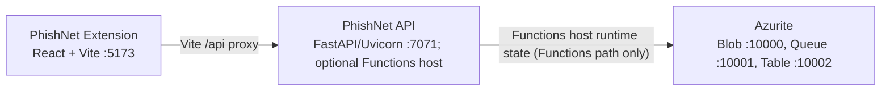

# Azure Debug Plan

> This plan is the source of truth for generating the
> VS Code debug setup in this workspace.
>
> **Status:** Executing
> **Execution Mode:** Guided
> **Created:** 2026-11-06T11:42:42+05:30
> **Last Updated:** 2026-11-06T11:58:15+05:30
>
> <!-- Guided Mode (default) - hand-holds the user through review and approval before generating. -->

---

## Prerequisites

| Tool / Extension | Category | Service(s) | Installed | Version |
|------------------|----------|------------|-----------|---------|
| Python | Runtime | phishnet-api | ✅ | 3.10.11 |
| pip | Package manager | phishnet-api | ✅ | 25.2 |
| pytest | Test runner | phishnet-api | ✅ | 8.4.2 |
| Azure Functions Core Tools | Runtime | phishnet-api | ❓ | — |
| Node.js | Runtime | phishnet-extension | ✅ | 22.17.1 |
| npm | Package manager | phishnet-extension | ✅ | 11.12.1 |
| Google Chrome | Browser | phishnet-extension | ✅ | 156.0.8078.80 |
| Docker | Container runtime | phishnet-api | ❓ | — |
| Docker Compose | Compose provider | phishnet-api | ❓ | — |
| `ms-azuretools.vscode-azurefunctions` | VS Code extension | phishnet-api | ✅ | 1.22.2 |

> ⚠️ **Action required:** Confirm tools marked ❓ are installed and ready before approving a Functions-host/emulator debug path. Azure Functions Core Tools is needed to launch the local Functions host; Docker and Docker Compose are needed for the existing Azurite container. The existing FastAPI/Uvicorn debug path does not require either Functions Core Tools or Azurite.

---

## Debug Configurations

The workspace already contains `.vscode/launch.json` and `.vscode/tasks.json`; the current entries run the FastAPI/Uvicorn fallback and the Vite browser preview. Preserve and merge these files rather than replacing them. `.vscode/settings.json` and `.vscode/extensions.json` are also present and will be preserved.

| Generate | Debug Config Name | Service Label | Service Root | Project Type | Runtime | Version | Azure Dependencies |
|----------|--------------------|---------------|--------------|--------------|---------|---------|--------------------|
| [x] | PhishNet API (debug) | PhishNet API (`phishnet-api`) | ./backend | functions | python | 3.10 | Azure Storage (Functions host) |
| [x] | PhishNet Extension (debug) | PhishNet Extension (`phishnet-extension`) | ./extension | frontend-spa | node-ts | 22.x | — |
| [x] | Debug All Services | Debug All Services | — | *Compound Config* | — | — | — |

ℹ️ Project Type Descriptions

| Project Type | Description |
|-------------|-------------|
| functions | Azure Functions — serverless compute with HTTP triggers and bindings |
| frontend-spa | Single-page frontend application served by a development server (Vite/React here) |

> ℹ️ **Proxy detected:** PhishNet Extension proxies `/api` requests from Vite to `http://127.0.0.1:7071` (PhishNet API). The compound configuration should start the API before the frontend.
>
> ℹ️ The backend is an Azure Functions Python v2 app wrapping FastAPI. The current API launch entry deliberately uses the documented Uvicorn fallback on `127.0.0.1:7071`; the current extension launch opens the Vite preview on `localhost:5173`. Its tasks verify Python dependencies and start Vite, but do not start an Azure Functions host or emulator. The extension's `public/manifest.json` is the MV3 package manifest; the current Chrome launch is a browser preview, not a loaded unpacked extension session.

### Existing Debug Configuration Inventory

| File | Current behavior | Planning decision |
|------|------------------|-------------------|
| `.vscode/launch.json` | Python `debugpy` launches `uvicorn app.main:app` on port 7071; Chrome launches the Vite page on port 5173; a compound starts both. | Preserve. Any Functions-host launch profile is an optional addition, subject to approval and confirmed prerequisites. |
| `.vscode/tasks.json` | Checks that FastAPI/Uvicorn import, starts the Vite dev server, and sequences the compound prerequisites. | Preserve. If the Functions-host path is approved, add separate Azurite/Functions tasks; do not make those a prerequisite for the working Uvicorn path. |
| `docker-compose.yml` | Starts a Functions API container on host port 7071 and an Azurite container on ports 10000–10002. | Preserve unchanged; do not run the Compose API and local Uvicorn simultaneously because both claim port 7071. |
| `api-test-collections/phishnet-api/` | Three PowerShell smoke invocations already exist for `/health`, `/api/health`, and `/api/analyze`. | Reuse as-is; scripts target `127.0.0.1:7071` and the analyze script reads `sample-data.json`. |

---

## Orchestrator

The existing root `docker-compose.yml` already defines the API and Azurite. Keep that file and its current service definitions unchanged; this plan only inventories the existing local emulator setup and does not create or alter Compose configuration.

| Orchestrator | Container Runtime | Compose Command | Description |
|-------------|-------------------|-----------------|-------------|
| Docker Compose | Docker (❓ runtime not confirmed) | `docker compose` (❓ not confirmed) | Existing root Compose file orchestrates the Functions API and Azurite. Neither Docker nor Podman, nor either Compose provider, was confirmed by the current shell probe. Verify an engine is installed and running and that `docker compose version` works before using this path. |

---

## Emulators

| Dependent Service | Emulator | Purpose |
|-------------------|----------|---------|
| Azure Storage | Azurite Container | Implicit Azure Functions host dependency for local runtime state; `backend/local.settings.example.json` sets `AzureWebJobsStorage=UseDevelopmentStorage=true`. The existing Compose file exposes Blob, Queue, and Table on ports 10000–10002. Not needed when using only the FastAPI/Uvicorn fallback, which has no application-level Azure SDK/binding dependency. |

---

## Architecture Diagram

During the currently configured local debug session, Vite forwards `/api` calls to Uvicorn on port 7071. If debugging via the Azure Functions host instead, that host uses Azurite for its local Azure Storage state.

---

## API Test Collections

| Generate | Service | Description |
|----------|---------|-------------|
| [x] | PhishNet API | Three anonymous HTTP endpoints. Existing PowerShell invoke scripts target the FastAPI/Uvicorn fallback at `127.0.0.1:7071`; keep and reuse them. |

### GET /health `http-health`

Existing: `api-test-collections/phishnet-api/http-health/invoke.ps1` — expects HTTP 200 and `status=ok`.

### GET /api/health `http-api-health`

Existing: `api-test-collections/phishnet-api/http-api-health/invoke.ps1` — expects HTTP 200 and `status=healthy`.

### POST /api/analyze `http-analyze`

Existing: `api-test-collections/phishnet-api/http-analyze/invoke.ps1` with `sample-data.json` (`https://example.com`) — expects HTTP 200 and a verdict in `low_concern`, `review`, or `high_risk`.

The route inventory in `backend/app/main.py` contains only these three GET/POST routes. API login is disabled in `.azure/project-plan.md`; no auth smoke tests are needed. Backend test coverage also includes invalid URL handling, but the existing smoke collection does not have a dedicated 422 invocation.

---

## Convenience Scripts

No additional convenience scripts are planned. Existing `npm run dev`, `npm run build`, `npm test`, backend test commands, and documented Functions/Uvicorn run commands remain unchanged. No database or migration files/dependencies were found.

---

## Approval Decisions Before Any Generation

1. **Debug target:** Keep the existing Uvicorn fallback as the default F5/compound target, or approve adding a separate Azure Functions-host debug target. The latter requires Azure Functions Core Tools and the Azurite emulator; both remain unconfirmed locally.
2. **Emulator startup:** If the Functions path is selected, approve adding an Azurite startup task that uses the existing Compose configuration (and verify the Docker/Podman runtime first). Do not start the Compose API alongside local Uvicorn on port 7071.
3. **Existing configuration preservation:** Confirm that future generation may merge the existing `.vscode/launch.json` and `.vscode/tasks.json` only, while leaving `docker-compose.yml`, source, and current smoke scripts unchanged unless a specific change is approved.
4. **Smoke test scope:** Keep the existing three smoke scripts only, or approve an additional invalid-request smoke case for `POST /api/analyze` (expected HTTP 422).

## Execution Selections

- Keep the existing Uvicorn/debugpy target at `127.0.0.1:7071`; do not add an Azure Functions-host target or emulator startup task.
- Preserve and merge the existing `.vscode/launch.json` and `.vscode/tasks.json`. Their entries already match the selected Uvicorn, Vite, and compound setup, so no configuration-file rewrite was needed.
- Leave `docker-compose.yml`, application source, and the three existing API smoke scripts unchanged. Do not add the invalid-input smoke test.
- Do not deploy or start services. Static JSON and task-reference validation was performed; live launch/compound validation is deferred.

## Debug Configuration Checklist

✅ PhishNet API (debug) — `launch.json` parsed; the Uvicorn/debugpy module, `127.0.0.1:7071`, and its pre-launch task were verified statically. The existing recorded smoke results above are historical; no service or debugger was started for this execution.
✅ PhishNet Extension (debug) — `launch.json` and `tasks.json` parsed; the Chrome target, `http://localhost:5173`, Vite task reference, and `npm run dev` script were verified statically. No dev server or browser was started for this execution.
❌ Debug All Services — Static references resolve, but live VS Code compound orchestration/readiness was not run, as requested. Startup ordering and debugger attachment remain unverified.

## Generation and Validation Limitations

- **Python debug support:** The generated API configuration uses the Python `debugpy` adapter to launch the README-documented FastAPI/Uvicorn fallback, not the Azure Functions Python worker. The Functions/Python reference is marked planned, and Azure Functions Core Tools was not installed or available on PATH. Select an interpreter with the backend requirements installed and install/recommend the VS Code Python and Python Debugger extensions. Add a separate Functions-host debugging path only after Core Tools and its local storage dependency are available.
- **Docker/Compose:** Docker was unavailable. Docker was not installed or started, Compose was not invoked or validated, and no claim is made that the existing `docker-compose.yml` runs. The file remains unchanged. No Azurite startup task is included in this fallback configuration.
- **Compound:** Per-service server/build smoke checks passed as recorded above; the actual VS Code compound launch was not run, so its coordinated debugger behavior is explicitly unverified.
- **This execution:** No services, emulators, smoke scripts, or deployment were started. The plan remains `Executing` until live validation is explicitly allowed and completed.
